# ACARS SDR Observatory

### Observación ACARS en 131.725 MHz con DragonOS, Grafana Alloy y Loki

Este proyecto documenta una recepción real de mensajes ACARS con un RTL-SDR Blog V4 y la presenta en un dashboard de Grafana. La estación conservó los mensajes JSON de `acarsdec`, los envió a Loki con Grafana Alloy y los exploró por tiempo, matrícula, texto, nivel y ruido.

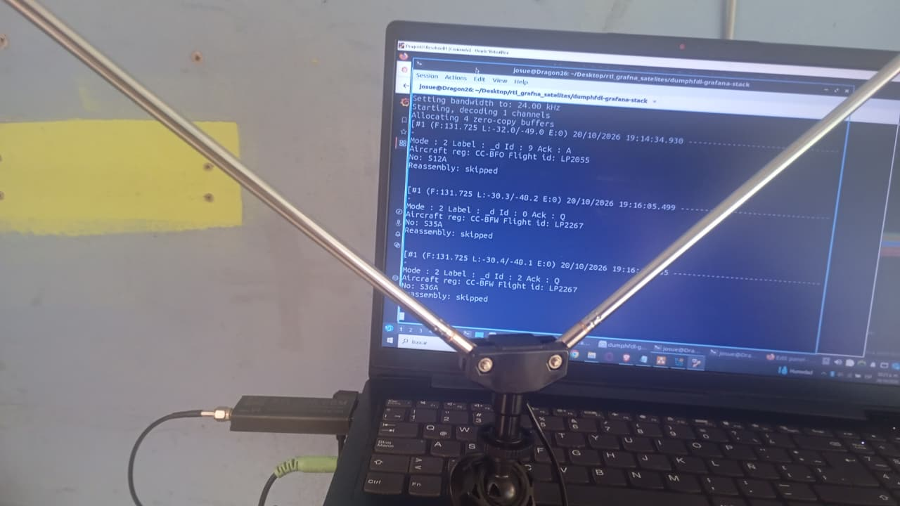

*Antena y receptor empleados durante la observación: RTL-SDR Blog V4 con sintonizador R828D.*

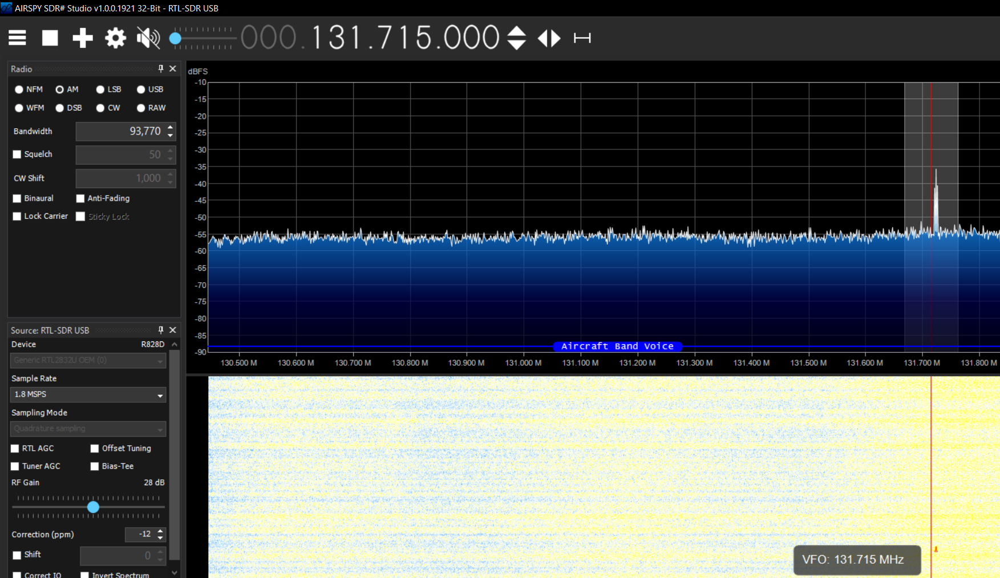

*La señal observada en SDR# corresponde a la frecuencia de recepción ACARS de 131.725 MHz. SDR# se utilizó para inspección visual de la señal; la decodificación documentada se realizó con `acarsdec` en DragonOS.*

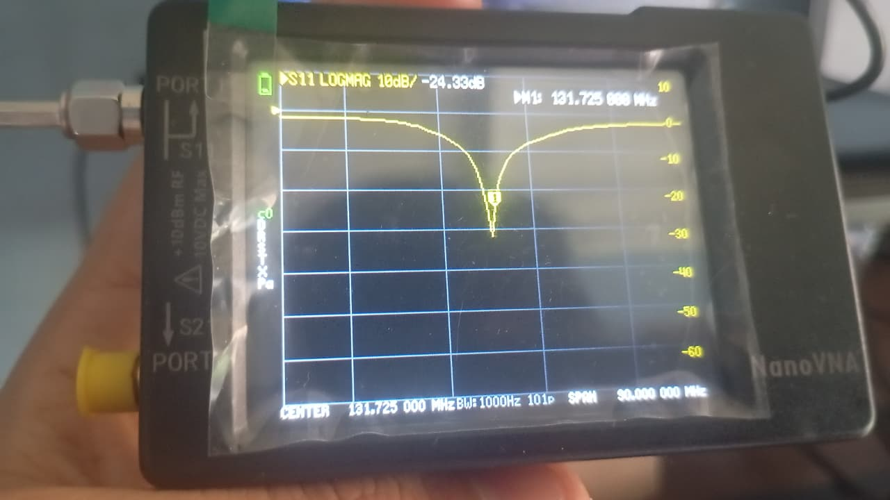

*Medición S11 de la antena usada para la estación.*

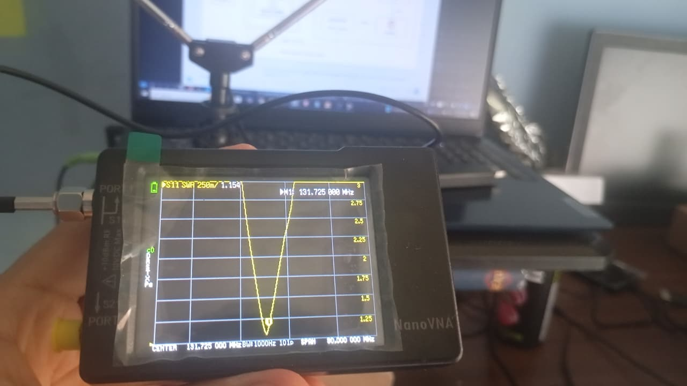

*La gráfica SWR incluye marcadores en 131.725 MHz. Esta captura no proporciona un valor de ganancia ni una medición de cobertura.*

## Resumen del proyecto

La sesión tuvo lugar el **20 de octubre de 2026**, entre **19:14 y 19:27 UTC** (**14:14–14:27, hora de Lima**). Se registraron **9 mensajes**, de **4 matrículas**; **3 mensajes** contenían texto. La captura final de Grafana muestra estos mismos conteos y los registros con `error=0` clasificados visualmente como INFO.

El objetivo fue crear una vista histórica y consultable de los mensajes ACARS recibidos por una estación SDR. El dashboard reúne el conteo de mensajes, aeronaves distintas, mensajes con texto, actividad por minuto, nivel y ruido por matrícula, registros completos, registros con texto y los mensajes que contienen marcadores `INIT` o `WXRQ`.

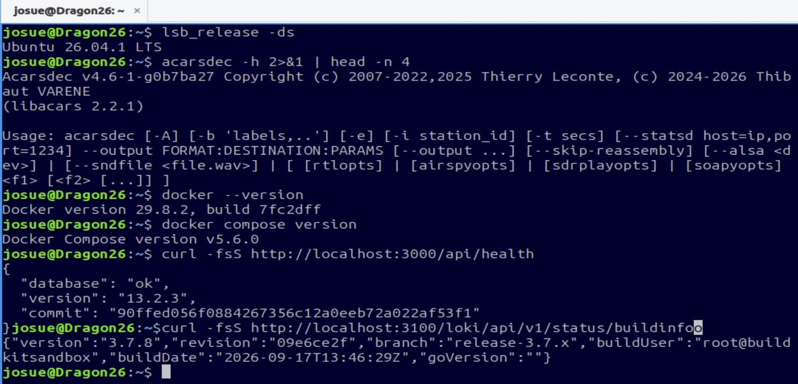

*Versiones de software registradas durante la recepción y la integración.*

| Componente | Versión o equipo observado |
|---|---|
| Sistema | DragonOS 26.1 |
| Decodificador | `acarsdec` v4.6-1-g0b7ba27 |
| Biblioteca ACARS | libacars 2.2.1 |
| Receptor SDR | RTL-SDR Blog V4, R828D |
| Colector de logs | Grafana Alloy v1.21.0 |
| Almacenamiento de logs | Loki v3.7.8 |
| Interfaz de visualización | Grafana v13.2.3 |

## Recepción y captura

`acarsdec` recibió la señal del RTL-SDR y produjo, en paralelo, salida de texto y JSONL. Los archivos JSON se conservaron como registros originales y sirvieron como fuente para la ingestión en Loki. Los datos observados incluyen la estación, frecuencia, canal, nivel, ruido, errores, modo, código de etiqueta, matrícula, identificador de vuelo y texto cuando esos campos estaban presentes.

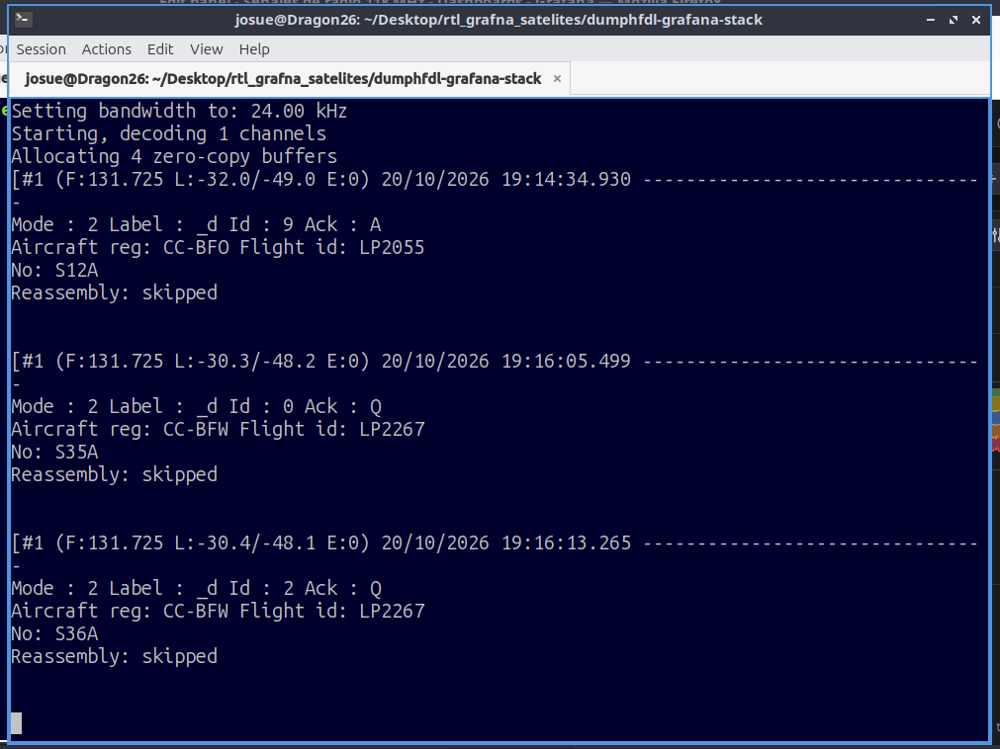

*La terminal muestra las líneas de mensajes entregadas por `acarsdec` durante la recepción.*

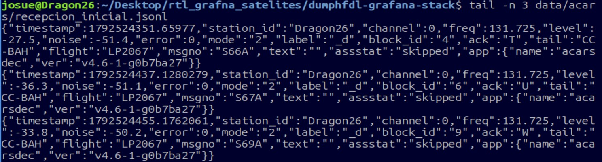

*El JSON conserva los campos decodificados que usan las consultas del dashboard. Los mensajes con etiqueta `_d` de esta muestra tienen el campo `text` vacío y se conservan en el conteo total.*

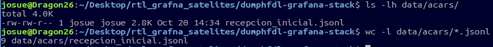

*Los mensajes se conservaron en archivos locales con rotación diaria UTC.*

La señal se recibió en **131.725 MHz**, con una ganancia del receptor configurada en **28 dB**.

## Esquema de datos e interpretación

Los nombres de campo mantienen separadas las distintas clases de información que entrega el decodificador:

| Campo | Interpretación en este proyecto |
|---|---|
| `tail` | Matrícula o identificador de aeronave presente en el mensaje |
| `flight` | Identificador de vuelo; puede diferir de `tail` |
| `label` | Etiqueta/código del protocolo ACARS, por ejemplo `80` o `5U` |
| `mode` | Modo de recepción indicado por ACARSDEC; el valor `2` no significa VDL2 |
| `level` | Nivel de señal relativo que reporta el decodificador |
| `noise` | Nivel de ruido relativo que reporta el decodificador |
| `error` | Conteo de errores que acompaña a cada mensaje recibido |
| `text` | Contenido decodificado cuando el mensaje incluye texto legible |

En particular, `CC-BAH` es el tail y `LP2067` el flight del mismo registro; no son valores intercambiables. De igual forma, `label=80` identifica el código de protocolo y no es un indicador de nivel RF. Los campos vacíos se conservan en contexto y no se convierten automáticamente en fallas de procesamiento.

## Recorrido de los datos

El flujo de observación está compuesto por la antena y el RTL-SDR, `acarsdec`, archivos JSONL, Grafana Alloy, Loki y Grafana. La salida StatsD hacia Graphite está configurada en el stack base; las series ACARS concretas de Graphite no forman parte de los resultados verificados aquí.

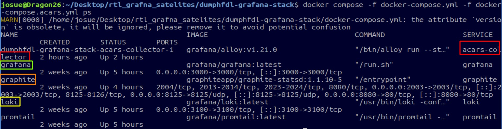

*Vista de los servicios que participaron en la observación y el almacenamiento.*

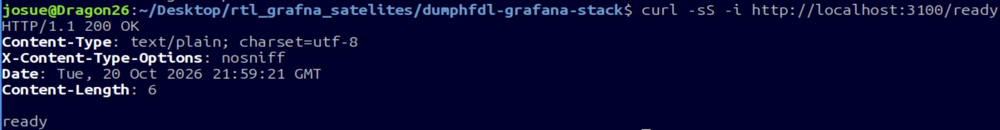

*Loki respondió como servicio disponible durante la validación.*

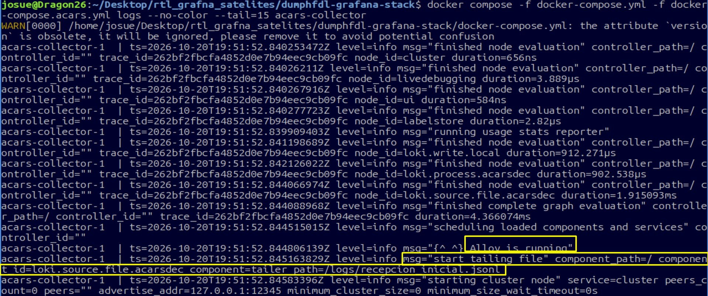

*Alloy leyó los archivos JSONL y envió los eventos a Loki, preservando el contenido y el timestamp del mensaje.*

La configuración de Alloy indexa etiquetas de baja cardinalidad para identificar el trabajo, la estación y la frecuencia. Matrícula, vuelo, nivel, ruido, error y texto se extraen al consultar el JSON; no se convierten en etiquetas indexadas. Esto permite agrupar registros por matrícula sin crear una serie Loki por cada valor de alta cardinalidad.

## Exploración en Grafana

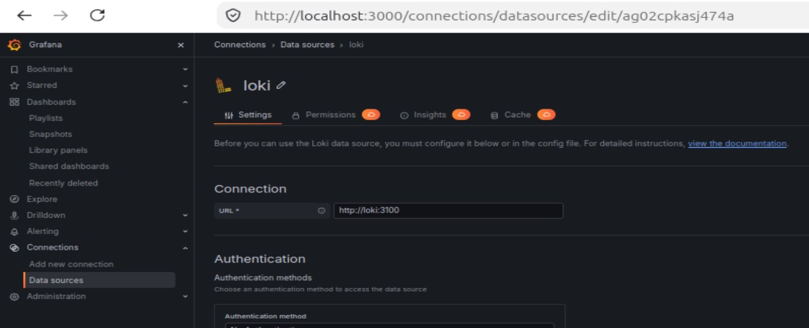

*La fuente de datos Loki conecta Grafana con los eventos de la estación.*

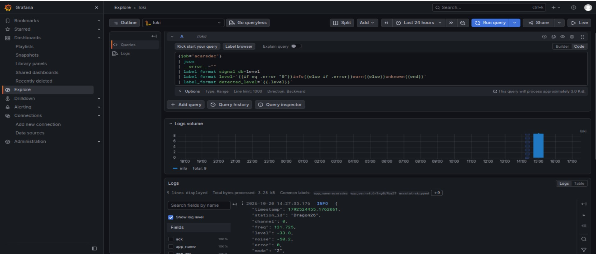

*Explore permite consultar los registros ACARS conservados por Loki dentro de un intervalo temporal.*

Los eventos del intervalo aparecen en Grafana usando su timestamp de ACARS. La selección de un rango de tiempo que cubra la sesión permite consultar los registros del 20 de octubre de 2026. La búsqueda puede filtrar los mensajes por contenido, además de mostrar el payload junto con los campos extraídos.

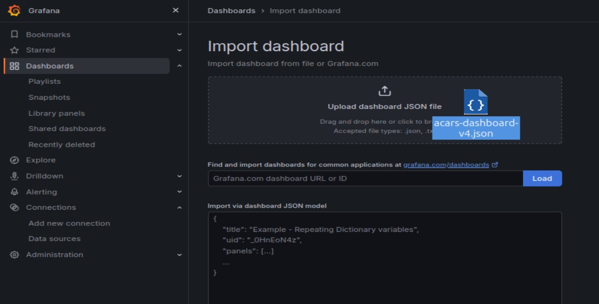

*El dashboard se integra como una vista de Grafana vinculada a la fuente de datos Loki.*

## Dashboard y resultados

*Resultado observado: nueve mensajes, cuatro matrículas distintas y tres mensajes con texto. Los registros sin errores de decodificación se presentan como INFO.*

El dashboard final contiene nueve paneles:

| Vista | Qué muestra |
|---|---|
| Mensajes en el rango | Total de registros ACARS en el intervalo elegido |
| Aeronaves distintas | Matrículas `tail` no vacías y distintas |
| Mensajes con texto | Registros con contenido no vacío en `text` |
| Mensajes por minuto | Conteo en ventanas fijas de un minuto |
| Nivel por matrícula | Promedio de `level` en ventanas de cinco minutos |
| Ruido por matrícula | Promedio de `noise` en ventanas de cinco minutos |
| Todos los mensajes | Campos principales y texto cuando existe |
| Mensajes con texto | Vista enfocada en payloads no vacíos |
| WXRQ e INIT | Registros cuyo texto contiene esos marcadores |

Las series de nivel y ruido se presentan en **dB relativos** reportados por el decodificador. No son medidas calibradas en dBm. Los paneles omiten valores que no puedan convertirse a número y separan los valores por matrícula. Los intervalos sin registros aparecen como huecos en la actividad, no como ceros observados.

La severidad mostrada en los paneles de logs se deriva del campo ACARS `error`: `error=0` se presenta como INFO, un valor no vacío distinto de cero como WARN y un campo ausente como UNKNOWN. El nivel RF se conserva por separado como `signal_db`; las etiquetas INFO/WARN/UNKNOWN describen el conteo de errores del mensaje, no la intensidad de señal.

*Detalle de los tipos de mensaje observados, junto con sus matrículas, identificadores de vuelo y texto disponible.*

Entre los datos de la sesión se observaron estos pares matrícula/vuelo:

| Matrícula (`tail`) | Vuelo (`flight`) | Evidencia de la sesión |
|---|---|---|
| CC-BFO | LP2055 | Mensaje recibido |
| CC-BFW | LP2267 | Mensaje recibido |
| CC-CPJ | LP2205 | Mensaje `LSRES`, `label=80` |
| CC-BAH | LP2067 | Mensajes `INIT` y `WXRQ`; también se observó `label=5U` |

En el `INIT` de CC-BAH/LP2067 apareció `SPJC/SPTN`. Se presenta como referencia de ruta escrita en el mensaje. No es una posición GPS ni una coordenada. `WXRQ` es un marcador de solicitud meteorológica ACARS; esta recepción no decodificó imágenes meteorológicas de satélite.

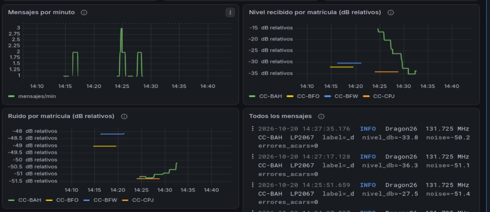

*Detalle de las series temporales por matrícula. Los valores reflejan los campos relativos de la salida del decodificador.*

## Alcance de la observación

La captura permite describir los nueve mensajes conservados y los campos que aparecen en ellos. No permite concluir que todos los paquetes transmitidos fueron recibidos, calcular una tasa de pérdida, deducir la cobertura de la antena ni localizar el receptor. Una línea con `text` vacío puede seguir siendo un frame ACARS válido.

ACARS y VDL2 son protocolos distintos que pueden recibirse en bandas VHF cercanas. Esta integración procesa ACARS; no incluye una recepción VDL2. Los gráficos de monitoreo RF que puedan existir en el stack base son independientes de este dashboard ACARS. Graphite está disponible como parte del stack, pero la visualización presentada aquí se basa en Loki.

*Resumen visual de la cadena de recepción, almacenamiento JSONL, transporte por Alloy, consulta en Loki y presentación en Grafana.*

## Componentes del proyecto

| Archivo o carpeta | Propósito |
|---|---|
| `acars.alloy` | Lectura de JSONL, asignación de timestamp y etiquetas de baja cardinalidad |
| `docker-compose.acars.yml` | Servicio auxiliar de Alloy para el stack existente |
| `acars-dashboard.json` | Dashboard de nueve paneles para Grafana |
| `start-acars.sh` | Configuración del decodificador y salida JSONL/StatsD |
| [Arquitectura](docs/ARQUITECTURA.md) | Recorrido de datos, puertos y almacenamiento |
| [Resultados](docs/RESULTADOS.md) | Evidencia de recepción e interpretación de los mensajes |
| `imagenes/` | Fotografías, capturas y diagrama del proyecto |

## Créditos

Esta integración amplía el stack de observabilidad [`alphafox02/dumphfdl-grafana-stack`](https://github.com/alphafox02/dumphfdl-grafana-stack), creado por cemaxecuter para flujos HFDL/VDL2. El stack de origen conserva su identidad y sus atribuciones; este proyecto documenta la incorporación de un flujo ACARS.

La decodificación se realizó con [`f00b4r0/acarsdec`](https://github.com/f00b4r0/acarsdec), proyecto upstream independiente. Este repositorio no reescribe ni reclama autoría del decodificador. La integración propia se publica bajo MIT; `acarsdec` conserva su licencia upstream GPL-2.0-only.
