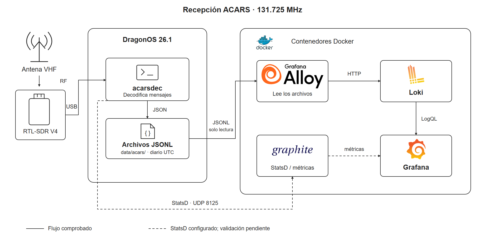

# Cómo funciona la estación

Este documento explica qué sucede entre la antena y el dashboard. Para ejecutar los programas, véase la [guía de uso](GUIA_DE_USO.md); para interpretar un mensaje, la [lectura de los datos](RESULTADOS.md).

## Qué hace cada componente

| Componente | Qué recibe | Qué entrega |
|---|---|---|
| Antena | La señal de radio que llega a la estación | Señal eléctrica al receptor |
| RTL-SDR Blog V4 | Señal de la antena | Muestras digitales al ordenador por USB |
| `acarsdec`, en DragonOS | Muestras del receptor | Mensajes ACARS decodificados en terminal y archivos JSONL |
| Grafana Alloy, en Docker | Las líneas de los archivos JSONL | Registros con fecha y etiquetas enviados a Loki |
| Loki, en Docker | Registros enviados por Alloy | Almacenamiento y consultas de los mensajes |
| Grafana, en Docker | Respuestas a las consultas de Loki | Contadores, gráficas y listas de mensajes en el navegador |

Docker ejecuta los servicios de observación. El acceso al receptor USB lo realiza `acarsdec` directamente desde DragonOS. En esta configuración el decodificador no está dentro de un contenedor.

## El recorrido de un mensaje

1. El receptor se sintoniza en **131.725 MHz** y entrega las muestras a `acarsdec`.
2. Cuando el decodificador reconoce un mensaje, imprime sus campos y escribe un objeto JSON en una línea del archivo. **JSONL** significa precisamente un objeto JSON por línea.
3. El script `start-acars.sh` guarda los archivos en `data/acars/`. La opción `rotate=daily` añade una fecha UTC al nombre: por ejemplo, `acars_20261020.jsonl`.
4. Alloy ve esa misma carpeta como `/logs` dentro del contenedor. El montaje es de solo lectura: puede leer la captura, pero no modificarla.
5. Alloy descubre los archivos `*.jsonl` cada cinco segundos. Extrae `timestamp`, `station_id` y `freq`; utiliza el primero como hora del registro y los otros dos como etiquetas.
6. Loki recibe la línea JSON original. Cuando Grafana solicita un intervalo, Loki busca los registros correspondientes y devuelve los resultados de la consulta.

Por ejemplo, `tail="CC-BAH"` viaja dentro del JSON. Una consulta puede extraerlo y filtrar los mensajes de esa matrícula. El dashboard no necesita acceder al RTL-SDR ni leer el archivo local por su cuenta.

La [documentación de acarsdec](https://github.com/f00b4r0/acarsdec#usage) describe sus salidas; la de [loki.source.file](https://grafana.com/docs/alloy/latest/reference/components/loki/loki.source.file/) explica cómo Alloy sigue los archivos y mantiene sus posiciones de lectura.

## La hora del mensaje y la hora de la pantalla

El campo `timestamp` es una fecha Unix: segundos desde el inicio de 1970, con su fracción de segundo. Alloy lo convierte en la hora de evento que guarda Loki.

Grafana presenta esa hora en la zona elegida por el navegador. Por eso **19:24 UTC y 14:24 en Lima representan el mismo instante**. La fecha UTC del nombre del archivo puede diferir de la fecha local cerca de medianoche.

El campo refleja la hora asignada por el ordenador receptor. Su reloj debe estar correcto. Copiar un archivo antiguo a la carpeta de lectura mantiene la fecha de sus registros; no los convierte en mensajes nuevos de la hora actual.

## Cómo se encuentran los mensajes

Loki guarda las etiquetas `job`, `station` y `freq`, junto con etiquetas de archivo que pueda añadir el lector. Estas identifican el origen de los registros. Los campos `tail`, `flight`, `text`, `level` y `noise` siguen dentro del JSON y se extraen durante la consulta.

Esta separación evita crear una combinación de etiquetas indexadas por cada vuelo o matrícula. Es el criterio de [baja cardinalidad recomendado por Loki](https://grafana.com/docs/loki/latest/get-started/labels/).

Grafana utiliza dos clases de consulta:

- **Mensajes:** muestra cada registro y su texto.
- **Resúmenes:** cuenta registros o calcula promedios de sus valores durante un intervalo.

La lectura numérica de `level` se conserva como `signal_db` en los paneles de mensajes. La clasificación visual INFO/WARN/UNKNOWN se calcula aparte a partir de `error`. Esto permite mostrar una señal de `-15.3` y un estado INFO en el mismo registro sin confundir intensidad con severidad. El JSON original permanece intacto.

## Conexiones entre programas

| Conexión | Dirección usada | Propósito |
|---|---|---|
| Navegador → Grafana | `http://localhost:3000` | Abrir el dashboard desde el ordenador de la estación |
| Grafana → Loki | `http://loki:3100` | Consultar registros por la red de Docker Compose |
| Alloy → Loki | `http://loki:3100/loki/api/v1/push` | Enviar registros por la misma red |
| Terminal → Loki | `http://localhost:3100/ready` | Comprobar que el servicio está preparado |
| `acarsdec` → StatsD/Graphite | `127.0.0.1:8125/UDP` | Salida adicional de estadísticas configurada por el script |

`localhost` identifica al programa que hace la petición. Dentro del contenedor Grafana, `localhost` sería el propio Grafana; el nombre `loki` permite alcanzar al servicio correcto en su red compartida.

La rama StatsD/Graphite transporta estadísticas, no las líneas JSON de los mensajes. El dashboard ACARS de este repositorio consulta Loki. La visualización de métricas ACARS de Graphite queda fuera de los resultados comprobados.

## Qué queda guardado

| Información | Ubicación | Comportamiento |
|---|---|---|
| Mensajes originales | `data/acars/`, en el host | Se mantienen aunque se detenga el receptor o Alloy |
| Posición de lectura de Alloy | Volumen `acars-alloy-data` | Permite continuar la lectura después de reiniciar el colector |
| Configuración del dashboard | `acars-dashboard.json` | Permite importarlo de nuevo en Grafana |
| Datos internos de Grafana, Loki y Graphite | Contenedores de los servicios | El Compose incluido no les asigna volúmenes de datos persistentes |

Detener y volver a iniciar los mismos contenedores conserva sus datos internos. Recrearlos puede perder ese estado si no existe un respaldo o una configuración adicional de persistencia. Los archivos JSONL son la copia local de los mensajes recibidos.

Un único programa debe utilizar el RTL-SDR a la vez. SDR# sirve para observar la señal en una sesión separada; durante la captura, el receptor queda a cargo de `acarsdec`.

## Reproducción de la muestra guardada

La [muestra incluida](../ejemplos/README.md) tiene un recorrido separado: `ejemplos/recepcion_acars.jsonl` → `scripts/cargar_muestra.py` → Loki → Grafana. El cargador envía directamente las líneas JSON, sin abrir el receptor ni pasar por Alloy.

Los registros reproducidos usan `job="acarsdec-demo"`; los de recepción real mantienen `job="acarsdec"`. El selector **Origen de datos** del dashboard elige cuál consultar. El cargador conserva el texto y el timestamp del JSON, y desplaza solo la hora de ingestión al presente para que la demostración pueda verse en un intervalo reciente.
