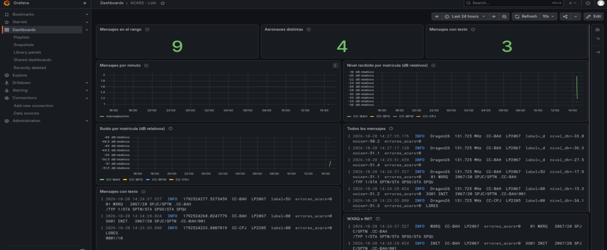
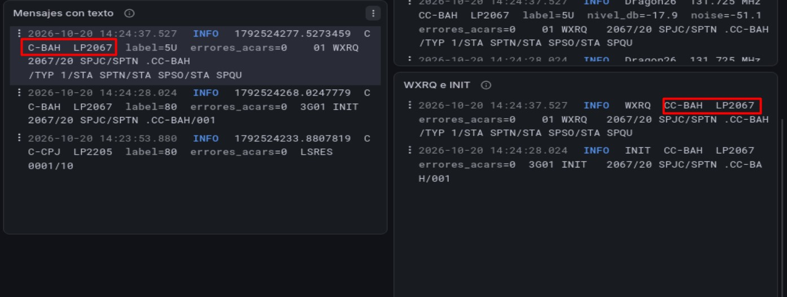

# Resultados de la recepción

## Versiones verificadas del stack

| Servicio | Imagen | Versión | Evidencia en DragonOS |
|---|---|---|---|
| Grafana | `grafana/grafana` | `13.2.3` | `/api/health`: commit `90ffed056f0884267356c12a0eeb72a022af53f1`, base de datos `ok` |
| Loki | `grafana/loki` | `3.7.8` | `/loki/api/v1/status/buildinfo`: revisión `09e6ce2f`, compilación `2026-09-17` |

## Condiciones documentadas

| Elemento | Valor observado |
|---|---|
| Plataforma de recepción | DragonOS 26.1 |
| Receptor | RTL-SDR Blog V4, sintonizador Rafael Micro R828D |
| Decodificador | acarsdec v4.6-1-g0b7ba27 |
| Biblioteca ACARS | libacars 2.2.1 |
| Frecuencia del canal | 131.725 MHz |
| Ganancia configurada | 28 dB |
| Colector | Grafana Alloy v1.21.0 |
| Fecha de la muestra | 20 de octubre de 2026 |
| Intervalo aproximado | 19:14:34–19:27:35 UTC / 14:14:34–14:27:35, Lima |

La ganancia es el ajuste del receptor; no expresa la potencia de la transmisión recibida. El modelo, dimensiones y montaje de la antena deben leerse junto a la foto real de la estación; no se asignan valores que no se hayan medido.

## Conteos en Grafana

La captura final del dashboard muestra **9 mensajes**, **4 matrículas distintas** y **3 mensajes con texto**. Los nueve registros de la muestra indican `error=0`.

| Matrícula | Identificador de vuelo | Mensajes en la muestra |
|---|---|---:|
| CC-BFO | LP2055 | 1 |
| CC-BFW | LP2267 | 2 |
| CC-CPJ | LP2205 | 1 |
| CC-BAH | LP2067 | 5 |
| **Total** | **4 identificadores observados** | **9** |

Los contadores son el resultado del intervalo seleccionado. Al continuar recibiendo o cambiar de intervalo, sus valores pueden variar.

## Contenido recibido

Los tres registros con contenido permiten mostrar el valor práctico de conservar los mensajes estructurados y consultar su texto.

| Texto o marcador | Matrícula / vuelo | Contenido observado |
|---|---|---|
| LSRES | CC-CPJ / LP2205 | `LSRES` seguido de `0001/10` |
| INIT | CC-BAH / LP2067 | Incluye `2067/20 SPJC/SPTN .CC-BAH/001` |
| WXRQ | CC-BAH / LP2067 | Incluye `/TYP 1/STA SPTN/STA SPSO/STA SPQU` |

Se conserva el texto tal como lo entregó el decodificador. WXRQ aparece como marcador de una solicitud meteorológica. No se afirma haber interpretado completamente los formatos de aplicación de la aerolínea. Los códigos de aeropuerto escritos dentro del mensaje no son coordenadas ni demuestran la posición actual del avión.

## Qué demuestra el resultado

1. El SDR recibió señales que acarsdec identificó y decodificó como mensajes ACARS en 131.725 MHz.
2. La salida se pudo conservar como JSONL y Alloy abrió el archivo de recepción.
3. Loki aceptó los registros con la hora original y Grafana permitió consultarlos.
4. El dashboard identificó matrículas, vuelos, contenido y niveles relativos por aeronave.
5. La presentación final muestra INFO para `errores_acars=0`, conservando la cifra de errores del decodificador.

## Alcance y límites

- Es una muestra de una estación y un intervalo; no garantiza actividad en esa frecuencia en cualquier ubicación.
- `level` y `noise` son valores relativos reportados por el decodificador, no dBm calibrados.
- Las gráficas promedian nivel y ruido en ventanas de cinco minutos.
- No se dispone de coordenadas en estos registros para presentar un mapa de posiciones.
- Los huecos de recepción no permiten calcular pérdida de paquetes ni cobertura.
- La rama StatsD hacia Graphite está configurada, pero las series y paneles ACARS de Graphite no forman parte del resultado verificado.
- Los JSONL y el estado de lectura de Alloy se conservan mediante directorio y volumen. El respaldo y la persistencia de Grafana, Loki y Graphite requieren una configuración adicional del despliegue.

Las imágenes 6, 7, 11, 13 y 15–17 enlazan estas conclusiones con la evidencia de terminal, archivos y Grafana. Las imágenes 3 y 4 documentan por separado S11 y SWR de la antena en 131.725 MHz. Los archivos IQ, audio y el conjunto completo de mensajes locales no se incluyen en el repositorio.
